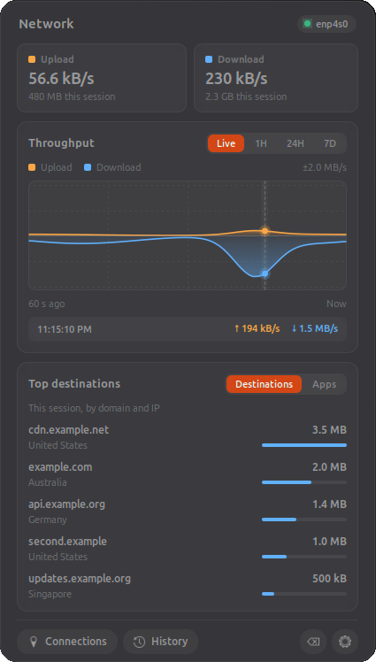
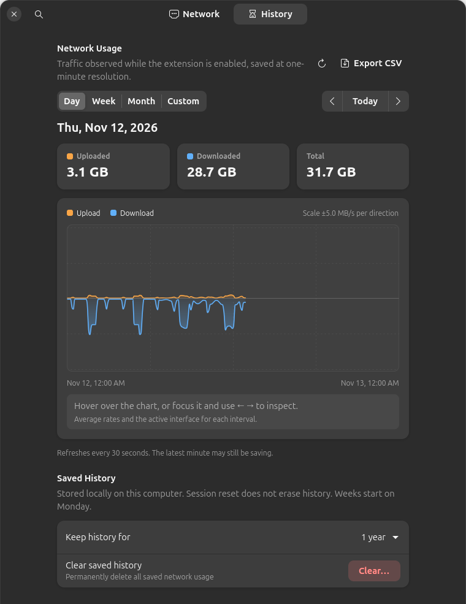
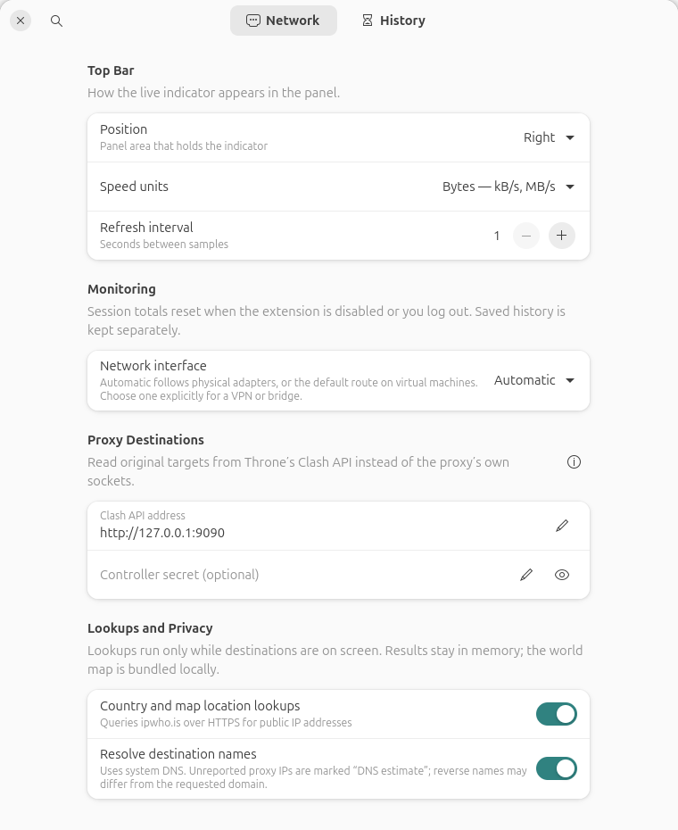

<h1 align="center">Topbar Network</h1>

<p align="center">
  <strong>Live network traffic, saved history and a world map of your connections,<br>right in the GNOME Shell top bar.</strong>
</p>

<p align="center">
  <a href="https://farvisun.github.io/topbar-network-indicator/">Website</a> ·
  <a href="https://github.com/farvisun/topbar-network-indicator/releases/latest">Download</a> ·
  <a href="#install">Install</a> ·
  <a href="#privacy">Privacy</a>
</p>

<p align="center">
  
  
  <a href="https://github.com/farvisun/topbar-network-indicator/actions/workflows/ci.yml"></a>
</p>

<p align="center">
  
</p>

## Highlights

- **Always-visible traffic.** Stacked upload/download speeds with a ten-bar chart that never shifts the panel layout.
- **Live and saved charts.** A mirrored area chart with Live, 1 hour, 24 hours and 7 days ranges, plus up to a year of local history you can browse by day, week, month or custom dates and export as CSV.
- **Top apps and destinations.** See which processes and domains used the most traffic this session.
- **World map.** An offline map of where your connections go, with optional Throne / Clash API integration for real proxy targets.
- **Private by design.** No telemetry, no background service, no root. History stays on your machine. [Details](#privacy)

<p align="center">
  
  
</p>

## Privacy

Everything is computed locally from `/proc/net/dev` and `ss`. The only optional network
requests are country and map lookups for **public** destination IPs through
`ipwho.is` (off with one switch) and DNS lookups through your system resolver (also a
switch). The proxy controller is only ever contacted on a loopback address. Nothing is
uploaded, and your Clash API secret is stored outside GSettings in a mode `0600` file.

## Overview

A local GNOME Shell 50 extension with a live 60-second traffic bar chart to the right
of stacked upload/download speeds in the top bar. Numbers occupy three monospace
characters and units occupy four, so speed changes never shift the chart. The ten
bars each show a time-weighted six-second average (oldest left, newest right). Orange upload appears above the center line;
blue download appears below it, using a shared automatic scale. The graph repaints
every sample even while the dropdown is closed and has an explicit panel allocation.
Click it for a mirrored area chart with Live, 1 hour, 24 hours, and 7 days ranges,
the five most used destinations or network apps, session totals, and saved history. Hover over the
chart or focus it and use Left/Right (Home/End) to inspect rates and timestamps.
Upload is orange above the center; download is blue below it. Gaps indicate missing
observations. Selected-range byte totals appear underneath.
**Connection details & world map…** opens a searchable destination ranking and
an offline world map with connection lines. Select a domain or map marker to see
its target IPs, countries, apps, protocol, route, current rates, and session totals.
Settings include panel position, bits/bytes, refresh interval, an optional interface,
and proxy destination and location options.

## Install

Download `topbar-network@farvisun.local.shell-extension.zip` from the
[latest release](https://github.com/farvisun/topbar-network-indicator/releases/latest), then:

```sh
gnome-extensions install --force topbar-network@farvisun.local.shell-extension.zip
```

Or build it from a clone with `./build.sh` (the zip is written to `dist/`).

Log out and back in so GNOME discovers the new extension. Then run:

```sh
gnome-extensions enable topbar-network@farvisun.local
gnome-extensions prefs topbar-network@farvisun.local
```

You can also enable it and open its settings using Extension Manager.

After installing an update, log out and back in to reload the JavaScript modules
and stylesheet. Toggling an already loaded extension may keep its old modules cached.

## How traffic is measured

Interface traffic reads Linux `/proc/net/dev` locally without network requests or extra services.
Automatic mode sums physical interfaces (including Wi-Fi and Ethernet) and excludes
loopback and virtual devices to avoid counting VPN/bridge traffic twice. With no
physical interfaces it uses the lowest-metric default IPv4 route, then IPv6.
For bridges, VPNs, containers, or unusual routing, set an explicit interface name
such as `wlp2s0`, `enp3s0`, or `tun0`. List names with `ip -brief link`.

Speeds use decimal units. Totals represent traffic observed while enabled, including
local network traffic. Session totals reset on logout, disable, or pressing Reset;
saved history is separate. No old traffic is added when an interface first appears.
After suspend the first displayed speed is zero until a fresh sample is collected.

## Saved history

Network usage is saved locally for **one year** by default. Open **Usage history…**
in the dropdown, or the **History** page in Settings. Browse calendar days, weeks
(Monday start), months, or an inclusive custom date range. Charts show average
upload/download rates over observed time; totals show bytes transferred. Dates use
the desktop timezone and handle daylight saving changes. Bits/bytes settings affect
speed labels; usage totals always use bytes.

History includes only intervals sampled while the extension is enabled. There is no
background service, and no traffic is recovered while logged out or disabled.
Suspend, failed reads, counter resets, interface changes and clock jumps break the
chart instead of producing artificial spikes. The uncertain interval is omitted
from saved history; session totals may include counter differences across suspend.
App and destination rankings remain session-only.

Minute buckets retain received/sent bytes, observed duration, observation boundaries
and the interface configuration. Multiple configurations remain distinguishable in
chart inspection and CSV. Partial-minute selections are estimated proportionally
within the bucket's observed boundaries; totals over complete buckets are exact.
Unobserved minutes remain gaps; short gaps within a minute share that minute's
average. Data from different monitoring configurations is combined in period totals.

Versioned daily JSON files live under
`$XDG_DATA_HOME/topbar-network/history/` (normally
`~/.local/share/topbar-network/history/`). Writes are asynchronous, serialized, and
atomic, once per minute and on clean disable. An abrupt shutdown can lose the latest
unflushed minute. Unreadable files are preserved and reported; other readable dates
remain available. If a write fails, collection continues in memory and retries on
the next flush. Saved interface history is never uploaded. Destination location
lookups are separate and described below.

The History page offers **7 days, 30 days, 90 days, or 1 year** retention, with pruning
at startup, daily, and when retention changes. **Export selected period as CSV…**
exports UTC timestamps, observed seconds, received bytes, sent bytes, and interface
configuration. Settings history refreshes every 30 seconds and may lag by the latest
unsaved minute; the dropdown can include its current in-memory observations.

**Clear…** requires confirmation and deletes saved history independently of session
totals and app rankings. A new storage generation immediately hides old records;
old files are removed, and pending saves cannot restore them. Collection continues.
**Reset session totals** never deletes saved history. Disable/uninstall does not
remove history automatically; use Clear first if you want to remove it.

## Most used apps

The dropdown ranks the five busiest process names by observed received + sent TCP
bytes since activation/reset, and shows their current upload/download rates and
relative traffic bars. Processes with the same name are grouped; closed apps keep
their observed totals. Existing connections start with a baseline so old traffic
is not counted. App sampling runs asynchronously with a timeout and is cancelled
on disable/reset.

Requires `ss` from iproute2 (normally already installed). No root access is requested.
Only processes visible to your user are attributable. UDP/QUIC, connections that
open and close between samples, and traffic after the last snapshot of a closed
socket are not counted. Upload uses acknowledged TCP bytes. Loopback is excluded;
app statistics cover all interfaces independently of the interface setting, so
these estimates will differ from interface totals. Restricted socket access or a
missing `ss` produces a status message without affecting the main traffic chart.

Visual reference: [Little Snitch traffic chart](https://help.obdev.at/littlesnitch6/lsm-traffic-chart).
Socket counters: [ss manual](https://man7.org/linux/man-pages/man8/ss.8.html).

## Domains, proxy targets, and the world map

The dropdown starts on **Destinations**, ranking domains (or IPs when no name is
available) by observed received + sent bytes since activation/reset. Switch to
**Apps** for the original process ranking. A proxy owns its external sockets, so
the Apps view can put **ThroneCore** first: this includes traffic it forwards for
other apps.

To see the actual domains behind Throne:

1. In Throne, open **Settings → Basic Settings → Sing-box → Clash API**. Set the
   listen address to `127.0.0.1` and the port to `9090` (or another free port).
   Copy the API secret if one is set, then restart the running Throne profile.
2. In this extension’s **Settings → Proxy Destinations**, enter
   `http://127.0.0.1:9090` and the same secret, using each field’s Apply button.
3. Open **Connection details & world map…** from the top bar. Allow new traffic
   to accumulate: the initial snapshot starts from zero.

The read-only integration uses the sing-box/Clash-compatible `GET /connections`
endpoint and supports TCP and UDP entries exposed by that controller. It never
changes Throne’s settings, routing, or connections. Only loopback controller
addresses are accepted, and redirects are refused. The optional secret is stored
in `$XDG_CONFIG_HOME/topbar-network/controller.token` (normally
`~/.config/topbar-network/controller.token`) with mode `0600`, outside GSettings.

Proxy connections are grouped by the requested domain. Where possible, the
original app is recovered by matching the proxy’s source IP/port with the app’s
local socket; otherwise the controller’s process name is used. Without either,
the app is shown as unreported. Proxy transport sockets are excluded while the
controller is available, preventing duplicate counts. If the API is unavailable,
direct TCP sockets still work and proxy endpoints are labelled as such; an
encrypted proxy tunnel alone cannot reveal the original target domains.

Existing connections are baselined on activation, reset, settings changes, and
controller reconnect. Direct sockets also rebaseline when controller availability
changes, omitting that transition interval. Closed targets retain their observed session totals, with
zero live connections/rates. Connections that start and finish between polls and
bytes transferred during an outage or after the last snapshot are not recovered.
Domain/proxy byte counts are estimates independent of interface history; they
include a different protocol layer. Session memory is limited to 2,000 targets
and 32 IPs per target. The details list/map shows the busiest 150 matching targets;
search covers the full retained list. Destination details are not saved to disk
or added to the historical interface CSV.

**Country and map location lookups** uses `https://ipwho.is/` for public destination
IPs while the destination dropdown or details window is visible. The map’s origin
is the approximate public exit seen by this service, which may be your proxy’s
exit rather than your physical location. Countries and coordinates are approximate
IP geolocation, and the lines link endpoints rather than tracing network hops.
The world geometry is bundled [Natural Earth public-domain land data](https://www.naturalearthdata.com/about/terms-of-use/);
no map tiles or domain names are sent to the location service.

Location results stay in memory during the session; lookups are serial, throttled,
and capped at 900 per enabled session per UTC day. Private, loopback, documentation,
multicast, and proxy benchmark/fake-IP addresses are not sent to the service.
Provider errors and rate limits leave IP/traffic details usable. Disable the
location switch to stop these requests.

**Resolve destination names and missing IPs** uses the system DNS resolver for
reverse names and for domains whose proxy IP is missing or virtual. These IPs are
labelled **DNS estimate** with dashed map links because the proxy may resolve to
a different IP. Reverse DNS is also labelled and can differ from the requested
domain. Disable this switch to stop those DNS queries. Unreported IPs and unknown
countries stay explicitly unavailable; a proxy endpoint is never substituted for
the target. The map/list supports keyboard focus, Left/Right and Home/End to select
targets, search by domain/IP/country/app, and Escape to close the window.

Controller reference: [sing-box Clash API](https://sing-box.sagernet.org/configuration/experimental/clash-api/).
Location service: [ipwho.is documentation](https://ipwhois.io/documentation).

## Build and check

```sh
gjs -m tests/network.js
gjs -m tests/chart.js
gjs -m tests/apps.js
gjs -m tests/connections.js
GSETTINGS_BACKEND=memory gjs -m tests/connectionMonitor.js
gjs -m tests/history.js
TZ=America/New_York gjs -m tests/history.js
./build.sh
```

For a GTK History page check (requires a graphical session; uses temporary history
and an in-memory settings backend):

```sh
GSETTINGS_BACKEND=memory gjs -m tests/preferences.js
```

To test the complete preferences entry point, including a dummy API secret,
use isolated configuration/data directories (never run this check against your
normal configuration directory). Library locations below are those on this host:

```sh
GI_TYPELIB_PATH=/usr/lib/gnome-shell/girepository-1.0 LD_LIBRARY_PATH=/usr/lib/gnome-shell \
  GSETTINGS_BACKEND=memory XDG_CONFIG_HOME=$(mktemp -d) XDG_DATA_HOME=$(mktemp -d) \
  gjs -m tests/settings.js
```

For an isolated GNOME lifecycle check (requires a session that permits a private
D-Bus and headless Wayland compositor):

```sh
dbus-run-session -- gnome-shell-test-tool --headless --extension dist/topbar-network@farvisun.local.shell-extension.zip tests/shell.js
```

Validation includes counter/formatting checks, panel and area chart timing/scaling
and offscreen Cairo rendering, and app socket parsing/ranking/delta/reset checks.
History checks cover byte conservation, persistence, corrupt files, write retries,
lifecycle races, clear-during-write, retention, CSV escaping, and local calendar/DST
boundaries. GTK checks cover loading, calendar modes, units, RTL chart direction,
and history clear confirmation. The shell check covers chart ranges, inspection,
persistence, clearing, and extension lifecycle, with a 30-second startup watchdog.
Connection checks cover proxy source-app matching, domain aggregation, IPv4/IPv6
classification, fake IPs, baselines/reconnects, failure/redirect/cancellation,
bounded state, offline map drawing, marker selection, and wrapping Pacific links.
The shell check also opens the world map, searches and inspects destinations, and
disables the extension with the window open. The schema is compiled strictly and
the build includes all modules and the land geometry.
On this host, passing `--disable-animations` to the
Shell test tool stalls compositor startup; keep the default animations enabled
as in the command above.

## Remove

```sh
gnome-extensions disable topbar-network@farvisun.local
gnome-extensions uninstall topbar-network@farvisun.local
```

API references: https://gjs.guide/extensions/development/preferences.html and
https://gjs.guide/extensions/upgrading/gnome-shell-50.html

## Contributing

Issues and pull requests are welcome. Please run the checks in
[Build and check](#build-and-check) before submitting, and never include real
traffic data, destinations or secrets in screenshots or bug reports.

## License

[MIT](LICENSE) © 2026 Mohammad Askari. World geometry is
[Natural Earth](https://www.naturalearthdata.com/about/terms-of-use/) (public domain).
